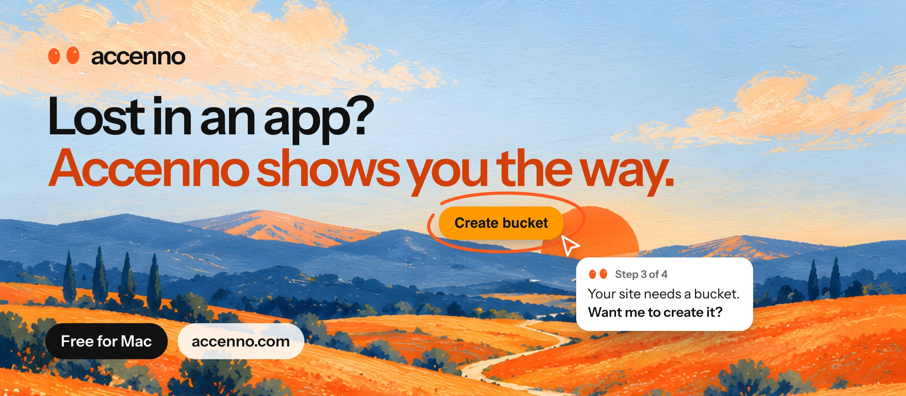

<h3 align="center">The Mac app that shows you where to click.</h3>

Ask out loud in any app. Accenno’s cursor points to the exact button, a small window beside it tells you the next step, or it does it for you.

  <a href="https://accenno.com/download/Accenno-0.3.0-arm64.dmg"><b>Download for Mac</b></a>&nbsp;&nbsp;&nbsp;&nbsp;
  <a href="https://accenno.com"><b>accenno.com</b></a>&nbsp;&nbsp;&nbsp;&nbsp;
  <a href="https://accenno.com/guide"><b>Install guide</b></a>&nbsp;&nbsp;&nbsp;&nbsp;
  <a href="https://accenno.com/brand"><b>Brand assets</b></a>

 

<table>
  <tr>
    <td width="50%" valign="top"><b>Day one with a new tool</b> AWS, Blender, Figma, Excel. Ask as you go instead of taking a course.</td>
    <td width="50%" valign="top"><b>Stuck for words in a meeting</b> When a question lands, it hands you the answer from your own notes. Live today.</td>
  </tr>
  <tr>
    <td width="50%" valign="top"><b>Asked to do it live</b> In an interview or on a client call, it quietly walks you through every click.</td>
    <td width="50%" valign="top"><b>It only looks when you ask</b> Nothing starts by itself, it asks before it clicks, and your files stay on your Mac.</td>
  </tr>
</table>

Free in early access. Apple silicon, macOS 15 or later. Windows and Linux are coming.

