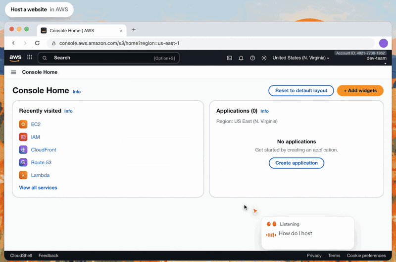
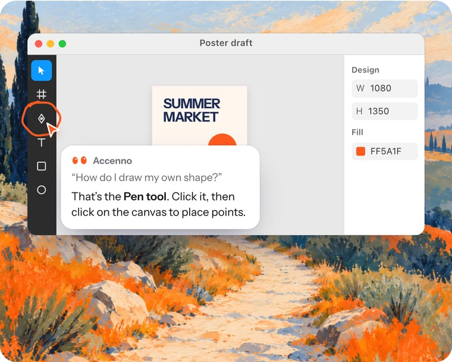
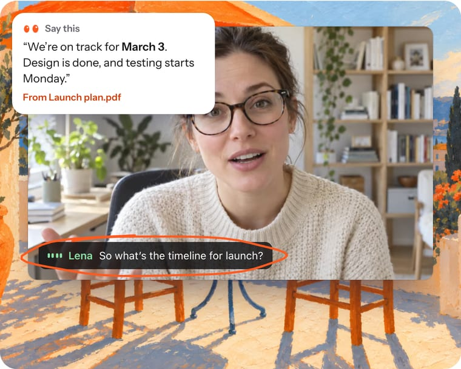
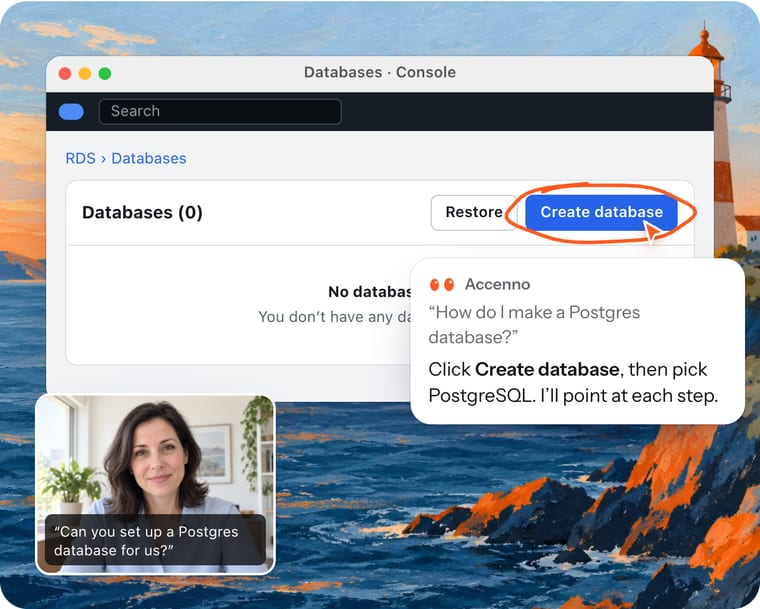
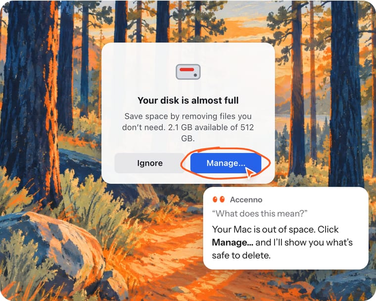

  
  
  

 

<h3 align="center">Watch it work</h3>

Accenno lives on your Mac, one question away, wherever you are. Its orange cursor flies to the exact spot, the window beside it tells you the next step, and when you say “do it”, it does the steps for you.

 

<h3 align="center">For every moment you get stuck</h3>

<table>
  <tr>
    <td width="50%"> <b>Day one with a new tool.</b> Figma, Blender, Excel, AWS. Ask as you go instead of taking a course.</td>
    <td width="50%"> <b>Stuck for words in a meeting.</b> When a question lands, it hands you the answer from your own notes.</td>
  </tr>
  <tr>
    <td width="50%"> <b>Asked to do it live.</b> In an interview or on a client call, it quietly walks you through every click.</td>
    <td width="50%"> <b>Plain lost.</b> An error you don’t get, a setting you can’t find. Just ask.</td>
  </tr>
</table>

 

<h3 align="center">It only looks when you ask</h3>

Nothing starts by itself. It asks before it clicks. Your files stay on your Mac.

 

<a href="https://accenno.com">accenno.com</a> · <a href="https://accenno.com/privacy">Privacy</a> · <a href="mailto:hello@accenno.com">hello@accenno.com</a>

